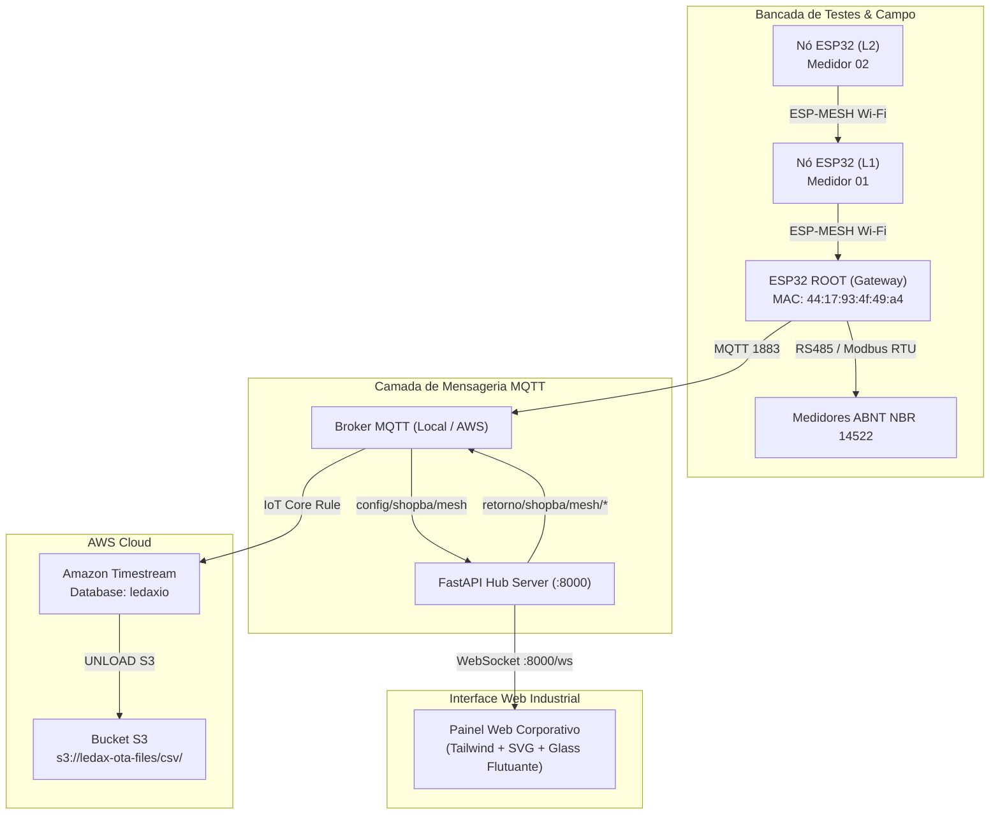

# ARQUITETURA.md - Documentação Permanente do Sistema

**Última Atualização**: 2026-11-15  
**Versão Atual**: `v2.9-pro`  
**Escopo**: Servidor de Telemetria, Orquestração ESP-MESH e Studio de Observabilidade Industrial da **Ledax Energy**.

---

## 1. Visão Geral da Arquitetura

O sistema é uma plataforma híbrida de observabilidade industrial e controle de bancada para medidores inteligentes de energia elétrica baseados no microcontrolador ESP32 com rede em malha (ESP-MESH) e comunicação em nuvem (AWS IoT Core & Amazon Timestream).

---

## 2. Subsistemas Principais

### 2.1 Backend FastAPI (`app.py`)
- **Autodescoberta ao conectar (LOCAL e AWS)**: `build_discovery_messages()` (função pura, testada em `tests/test_discovery_messages.py`) monta só comandos `query`: `topology` para `root` e `ping` para `any` (com `for_mesh`), em `config/` e `dev/config/`. No LOCAL também envia `topology` via `any` e repete a rodada após o gatilho UDP.
- **Janela de presença**: um Codax é considerado online até `NODE_ONLINE_THRESHOLD_SECONDS` (padrão 600 s, variável de ambiente) após a última mensagem dele. O heartbeat real (`dev/conn`) chega a cada ~210 s (NODE) e ~265 s (ROOT); a janela antiga de 180 s fazia Codax ativos "piscarem" offline.
- **Limite conhecido do modo AWS**: a plataforma assina apenas `config/shopba/mesh` e `dev/#` (a política AWS IoT derruba a conexão em tópicos PROD restritos). Respostas de Codax compilados em PROD (`retorno/`, `topo/`, `conn/` sem `dev/`) não chegam neste modo.
- O contador **"Na Malha"** do topo mostra Codax respondendo agora (`is_online` em `/api/discovered`); o total visto desde que o servidor iniciou fica no tooltip.
- **Servidor REST & WebSocket**: Porta padrão `8000`.
- **Roteador MQTT**: Subscreve tópicos de telemetria e retorno da malha (`retorno/shopba/mesh/#` e `dev/retorno/shopba/mesh/#`).
- **Amazon Timestream LiveAnalytics**:
  - Banco: `ledaxio` (Região `us-west-2`).
  - 7 Tabelas Mapeadas: `SHOPPBA-TESTE`, `test_connections`, `connections_mesh`, `connections`, `dev`, `refrix`, `water_gti`.
  - Exportador UNLOAD S3: Geração de SQL analítico e exportação direta sem compressão com delimitador `;` para Excel pt-BR.
- **Radar Sci-Fi & Observabilidade de Borda**:
  - Fasores polares de tensão e corrente com THD.
  - Sincronizador CSMA/CA heurístico para eliminação de colisões Wi-Fi na bancada.
  - Vigilante FreeRTOS de inversão de prioridade.
  - Vigilante Live Diff de Registradores Modbus (`40001` a `40012`).
  - Espectrograma RF de 14 canais 2.4GHz com recomendador dinâmico.
  - **Tomografia RF & Radar Wi-Fi CSI (Channel State Information)**:
    - Endpoints `/api/csi/status`, `/api/csi/{mac}`, `/api/csi/calibrate`, `/api/csi/burst`.
    - Algoritmo de entropia espectral e extração das 64 subportadoras OFDM para detecção de perturbação e movimento sem câmeras.
  - **Engine de Linha do Tempo Sci-Fi de Topologia**:
    - Endpoints `/api/scifi/metrics` e `/api/scifi/simulate-event`.
    - Registro cronológico de transições de camada (`L1 ROOT ⇄ L2/L3 NODE`), handovers e reconexões ESP-MESH.

### 2.2 Frontend SPA (`static/index.html`)
- **Estética Corporativa Industrial (Zero Glassmorphism)**:
  - Design estritamente Dark Carbon Industrial SCADA (`#070b14`, `#0b1120`, `#0f172a`) com bordas sólidas Slate (`#1e293b`, `#334155`), tipografia de alto contraste e zero desfoque (`backdrop-filter: none !important`).
  - **Tema SCADA Dark High-Contrast**: Modo alternativo de alto contraste para bancadas industriais (paleta âmbar fosforescente `#ffb000` e ciano laser `#00f0ff` sobre preto profundo `#06090e`, ativável no cabeçalho em 1 clique).
- **Abas do Sistema**:
  1. `view-quick`: Ações rápidas de bancada em 1 clique.
  2. `view-builder`: Construtor de comandos MQTT (funções ABNT NBR 14522 e JSON).
  3. `view-devices`: Gestão de dispositivos, MACs, nomes, tipos e **Exportador de Dossiê Técnico HTML Único** (relatório executivo offline para auditoria e impressão).
  4. `view-tree`: **Árvore Topológica ESP-MESH Panorâmica & Conduítes Laser Cyberpunk**:
      - **Fonte única: `query topology` (regra do sistema desde v2.9)**:
        - A árvore é montada **exclusivamente** a partir das respostas de `query topology` (tópico `[dev/]topo/shopba/mesh/<root>`). Nenhum ROOT é inferido por "ausência de pai"; heartbeats/ping atualizam só status e sinal, nunca a posição na árvore.
        - O site envia `query topology` (endereço `root` = `ff:00:00:01:00:00`, em PROD **e** DEV, somente leitura) ao abrir a aba e a cada 60 s enquanto ela está visível (intervalo mínimo de 8 s entre consultas automáticas). Cada resposta recebida via WebSocket recarrega `GET /api/topology`.
        - Formato real do firmware: `{"page", "root": "<mac>(<id>)", "router_mac", "router_rssi(dB)", "total_devices", "mesh": ["|layer: N|mac: ..|id: ..|parent_id: ..|rssi: .. |", ...]}`. **`parent_id` é o id (nome) do pai**, não o MAC; `0` = roteador (o ROOT). Quando vier um MAC, pode ser o da interface SoftAP (= MAC base + 1) e a resolução tenta MAC−1/+1.
        - Parser puro em `topology_parser.py` (`parse_topology_payload`, `build_mesh_tree`), coberto por `tests/test_topology_parser.py` (inclui o payload real da bancada). O backend guarda um snapshot por ROOT em `app_state["mesh_topologies"]`; a página 1 inicia um snapshot novo e as páginas seguintes são somadas. Snapshot com mais de 300 s é marcado como `stale`.
        - Layout: cada Codax fica na **linha da camada reportada** (ROOT · L1 no topo, L2, L3, ...), com colunas no estilo "tidy tree" (pai centralizado sobre os filhos). Um nó cujo pai não aparece na topologia é exibido na sua camada com o selo "Pai não encontrado" e sem linha.
      - **Fluxo animado por camada**: cada enlace tem a cor da camada do filho (ROOT índigo, L2 ciano, L3 esmeralda, L4 âmbar, L5 rosa), velocidade do pulso proporcional ao RSSI, partícula de descida (ROOT → filho) e de subida (telemetria), em cascata por camada, e um rótulo de dBm no enlace. Com `prefers-reduced-motion`, a animação é desligada.
      - **Linhas Animadas de Fluxo de Pacotes (Conduítes Laser Z-20)**: Renderização vetorial SVG de alta definição com duto escuro industrial (`#070b13`), trilho de fibra ótica (`#141c2c`), feixe laser contínuo em CSS GPU e partículas viajantes via `animateMotion`. Enlaces offline são renderizados como conduítes tracejados em slate (`.tree-flow-offline`) com supressão de partículas.
      - **Topologia Fiel & Validação Anti-Alucinação (Truth-Telling Live Topology)**:
        - Detecção real de presença baseada em batimento cardíaco MQTT (`last_seen_epoch`, janela de 180s) no backend FastAPI (`is_node_online()`).
        - **Seletor de Modo de Exibição**: `[ 🟢 Apenas Online ]` (padrão) oculta malhas com topologia desatualizada e ROOT sem sinal; `[ 🌐 Todos ]` mostra todas e lista à parte os Codax cadastrados que não aparecem em nenhuma topologia.
        - Cards de dispositivos offline exibem badge `🔴 OFFLINE`, ausência de sinal e carimbo do último contato registrado.
      - **Docking Ports Industriais**: Sockets de ancoragem física iluminados nas bordas inferiores (saída pai) e superiores (entrada filho) de cada placa.
      - **Flashes de Tráfego de Dados em Tempo Real**: Conduítes disparam pulsos instantâneos de alta luminosidade (`.tree-conduit-data-burst`) sincronizados com mensagens MQTT via WebSocket.
      - **Inovações Vadims06/topolograph**:
        - **Inspeção de Caminho Mais Curto (Shortest Path)**: Ao focar em qualquer nó, traça e ilumina todo o trajeto desde o ROOT com laser azul-gelo de alto brilho (`#38bdf8`), destacando saltos e métricas de rota.
        - **Simulador de Falha de Enlace / Nó**: Botão em cada card para simular queda de nó, transformando o conduíte em feixe vermelho tracejado piscante de alerta (`#f43f5e`) e alertando sobre rotas isoladas.
      - **Métricas IoT edfungus/Crouton & Freeboard**: HUD superior com Vazão da Malha em tempo real (PPS), LQI Médio de Rádio (%), contagem de malhas ativas e enlaces.
      - **Visão Matriz de Adjacência N x N em 4K** (heatmap de enlaces RF) e **Histórico de Mudanças de Topologia em Linha do Tempo**.
  5. `view-dictionary`: Dicionário de comandos, parâmetros e registradores Modbus/NBR 14522.
  6. `view-ota`: Gerenciador de atualizações de firmware Over-the-Air.
  7. `view-logs`: **Console de Mensagens ao Vivo & SCADA DevTools (Modern Deep Dark Obsidian)**:
      - **Modo Compacto (Wireshark / Chrome DevTools Strip)**: Apresentação de 1 linha por pacote com timestamp, badge semântico, MAC/Apelido do dispositivo, tópico com realce e resumo compacto dos campos (`{ v_a: 220.4 | status: "ok" }`). Reduz a altura visual em mais de 85% para análise de tráfego intenso.
      - **Ordenação Temporal do Stream (`[ ⬇️ Recentes no Topo ]` vs `[ ⬆️ Antigos no Topo ]`)**:
        - Alternador dinâmico de fluxo cronológico: no modo *Recentes no Topo* (padrão), pacotes mais novos (ex: 07:31) entram imediatamente na primeira linha superior e empurram pacotes anteriores (07:30) para baixo, ancorando o leitor no topo (`scrollTop = 0`) e eliminando o scroll manual descendente contínuo.
        - No modo *Antigos no Topo*, restaura o fluxo cronológico convencional tipo terminal terminal CRT com auto-scroll no rodapé. Preferência salva em `localStorage` (`codax_console_sort_order`).
      - **Visualização Expandida com Syntax Highlighting Real de JSON**: Tokenizador léxico puro nativo que colore chaves (`#38bdf8`), strings (`#fde047`), números (`#34d399`), booleans (`#c084fc`) e nulls (`#fb7185`) sobre poço debossed Jet Black `#020306`.
      - **Modo Dividido / Split Screen (2 Colunas Lado a Lado - `[ ◫ 2 Colunas ]`)**:
        - Divide a janela do terminal em duas colunas paralelas sincronizadas em tempo real.
        - Cada coluna possui seu próprio seletor independente de tópico (ex: Coluna 1 monitorando *Telemetria* e Coluna 2 monitorando *Retornos* ou *Conexão*), permitindo comparação visual imediata sem misturar os fluxos.
      - **Multi-Seleção Bimodal de Tópicos (Até 2 Tópicos Simultâneos)**:
        - Na barra de categorias com ícones vetoriais monocromáticos Lucide (`activity`, `git-fork`, `radio`, `terminal`, `alert-triangle`, `layers`), o operador pode selecionar 2 tópicos ao mesmo tempo para fluírem juntos na mesma lista com badge indicador ativo.
        - Stream 100% contínuo sem interrupção de pacotes (eliminação do botão de pausa para conformidade com telemetria viva).
      - **Chave Seletora de Dispositivos & Chips de Filtragem por MAC**:
        - O botão `Todos (N)` permanece sempre fixo e visível na barra de atalhos.
        - Chave seletora com dropdown suspenso (`[ 🎛️ Dispositivos (K) ▾ ]`) listando todas as placas detectadas e cadastradas com status online/offline, contagem viva de mensagens e checkboxes `[✓]`.
        - Apenas os dispositivos explicitamente marcados pelo operador são promovidos a botões clicáveis na barra rápida, evitando sobrecarga visual.
        - Seleção salva de forma persistente em `localStorage` (`codax_selected_mac_chips`), com atalhos rápidos `[ Marcar Todos ]` e `[ Desmarcar Todos ]`.
      - **Contadores de Categorias em Tempo Real**: Pílulas de filtro com contagem viva (`Todos`, `Retornos`, `Telemetria`, `Topologia`, `Conexão`, `Comandos`, `Erros`).
      - **Busca com Realce `<mark>`**: Filtro instantâneo com destaque em amarelo dos termos encontrados nos tópicos e payloads, acompanhado de botão de limpeza rápida `✕`.
      - **Ações Rápidas & Exportação**: Botão para download direto do histórico filtrado em arquivo `.json` com timestamp, cópia rápida para clipboard de payload ou tópico, e atalhos diretos `Cockpit` e `Builder`.
  8. `view-timestream`: **Estúdio Visual Amazon Timestream & UNLOAD S3**:
      - 5 Sub-Abas operacionais: `Séries & Curvas Elétricas`, `Catálogo das 7 Tabelas`, `Construtor UNLOAD S3`, `Console SQL & Queries`, e `Qualidade de Energia (PQI)`.
      - Gráficos vetoriais de alta resolução: Tensões Trifásicas (Va, Vb, Vc) com faixas normativas ANEEL (201V a 231V), Corrente (A) & Demanda Ativa (kW), Totalizador pt-BR contínuo e RSSI MESH.
      - Seletor de janela temporal: 15m, 1h, 6h, 24h, 7d e histórico consolidado.
      - Biblioteca de 6 presets SQL industriais em 1 clique (Totalizador, VTCD, Demanda de Pico, Saltos de Camada, Auditoria de Resets e Gaps).
      - Painel de Indicadores de Qualidade de Energia (PRODIST Módulo 8 da ANEEL: Desbalanço trifásico, Frequência, Fator de Potência).
      - Exportador de dados para CSV pt-BR (delimitador `;`), JSON e comando analítico UNLOAD TO S3 sem compressão.
  9. `view-scifi`: Radar de observabilidade avançada, **Diagrama Sankey de Fluxo MQTT por Tópico** (com curvas de Bézier animadas e modos volume vs largura de banda), **Detector de Gaiola de Faraday & Desvanecimento por Multipath RF (&lambda;=12.5cm)** e fasores elétricos.
  10. `device-cockpit-drawer`: Gaveta Lateral Deslizante (Slide-over Drawer / Tela Cheia) do Cockpit 360° de Codax Específico:
      - **Endpoint Backend**: `GET /api/devices/{mac}/cockpit` (Telemetria, Topologia, Power Reasons, Timestream, Logs e OTA em < 20ms).
      - **Telemetria Completa**: Va, Vb, Vc, Ia, Ib, Ic, Potência Ativa (kW), Reativa (kvar), cos φ, Frequência, THD-V/I, Temperatura do silício (°C) e RSSI/RTT.
      - **Micro-Topologia de Malha**: Parente (Pai), Filhos conectados, Canal Wi-Fi e Mesh ID.
      - **AWS Timestream & Power Reasons**: Histórico de códigos de reset do ESP32 (`POWERON_RESET`, `SW_CPU_RESET`, `BROWNOUT_RESET`, `TG0WDT`) e tabela das últimas 20 leituras da placa.
      - **Terminal Filtrado**: Console ao vivo e envio de comandos estritamente para o MAC em foco.
      - **Central OTA**: Status de partição ativa (`ota_0`/`ota_1`) e disparo de firmware (.bin) para a placa selecionada.
      - **Gêmeo Digital Holográfico 3D (Sub-aba 6)**: Renderização Three.js/WebGL em tempo real da placa ESP32 com LEDs dinâmicos vinculados ao MQTT, mapa térmico da CPU, **mapeamento interativo dos 30 pinos físicos** com hover raycasting e níveis de tensão (HIGH/LOW/Touch/RS485), **cabo virtual e módulo ESP-Prog Plug & Play** sincronizado automaticamente com a porta USB/Serial e **conduíte laser de pacotes de dados RS485** com partículas fótons em tempo real.
      - **Radar Wi-Fi CSI & Tomografia RF (Sub-aba 7 & Modal)**: Sonar polar com varredura contínua de feixe, decaimento fosforescente, 64 subportadoras OFDM e detecção de movimento volumétrico.
      - **Menu Corporativo MQTT**: Dropdown em Solid Dark Carbon com comandos agrupados em `Query`, `Change` e `Settings`.
      - **Faixa Docked Inferior (Carrossel Horizontal de Codax)**: Barra fixa ancorada no rodapé da gaveta com carrossel deslizante suave dos outros Codax da bancada, anel luminoso no dispositivo ativo (`ATIVO`), métricas de RSSI, RTT e protocolo de medidor, permitindo alternância instantânea sem fechar o Cockpit.
  11. `view-serial`: **Monitor Serial USB (ESP-Prog & UART Direta)**:
      - Espelhamento em tempo real da saída serial física via Web Serial API nativa (`navigator.serial`) a 115.200 bps (ou 74.880 ROM / 921.600 bps).
      - Decodificação ANSI em tempo real de logs do ESP-IDF (`[I]` Verde, `[W]` Amarelo, `[E]` Vermelho, `[ROM]` Roxo).
      - Controles de Hardware DTR/RTS para reset remoto da placa (`EN`) e ativação do modo bootloader (`GPIO0`).
      - Detector automático de SoftAP (`CODAX_XXXXXX`) e IP local (`192.168.4.1`) na saída da UART.
  12. `view-webserver`: **Webserver Local do ESP32 & Portal de Comissionamento**:
      - Acesso embutido e externo ao portal de configuração HTTP do ESP32 (`http://192.168.4.1`), operando 100% offline mesmo com a AWS fora do ar.
      - Mecanismo de contingência para forçar o modo Webserver a qualquer momento (via comando serial de NVS ou MQTT `config_state`).
      - Painel de credenciais de fábrica (`user/user` e `dev/admin`) com atalhos de consulta e reset de senha.
      - **Modo Visão Dividida (Split Screen)**: Visualização simultânea 50%/50% do Monitor Serial e do Webserver para comissionamento assistido em bancada.
  13. `view-innovations`: **Central de Inovações & Tecnologias TRL-9 (Aba Dedicada)**:
      - Acesso via botão de cabeçalho (`#top-btn-innovations`) preservando o menu lateral limpo.
      - Silenciamento completo de notificações pop-up toast de novas inovações, mantendo as atualizações silenciosas no cofre `innovations_vault.json`.
      - **Guia Didático 'Como Funciona na Bancada Codax'**: 4 pilares de engenharia (Curadoria TRL-9, Chave Seletora & Busca, Copiar Prompt Direto e Cofre Permanente).
      - **Chave Seletora de Categorias Industriais**: Botões pílula com contagem viva (`Todas`, `Favoritas ⭐`, `IA & Automação`, `RF & ESP-MESH`, `Design System & 3D`, `Aplicações IoT`, `Cibersegurança`).
      - **Grid Responsivo de Inovações**: Cards com badges temáticos, princípios de física/engenharia, impacto direto na bancada Codax, tags e botão de cópia de prompt pronto com 1 clique.
  14. **Mini-Sidebar Retrátil Industrial & Responsividade Mobile**:
      - **Cabeçalho Industrial Cockpit SCADA**: Emblema de hardware em carbono escuro com gradiente multicamada (`#0c1322` a `#03060a`), borda micro-iluminada em ciano aeroespacial (`border-cyan-500/40`), brilho suave de ancoragem e ping pulsante de vida da malha (`animate-ping`).
      - Tipografia corporativa de alta precisão com `CODAX` em kerning expandido, micro-pill `2.9 PRO` debossed escuro e indicador `ESP-MESH SCADA`.
      - Alternador instantâneo com tecla tátil metálica (`#btn-sidebar-collapse`) e ícone dinâmico (`panel-left-close` / `panel-left-open`).
      - Modo mini-dock com largura compacta (76px em desktop, 68px em mobile) com alinhamento vertical estrito do emblema e do botão no `#sidebar-brand-header`, centralizando os ícones das abas e ocultando rótulos e feeds secundários.
      - Persistência contínua do estado no `localStorage` (`codax_sidebar_collapsed`) e inicialização inteligente adaptada para telas móveis e tablets (< 768px e < 1024px).
  15. **Console ao Vivo - Esteira Aberta de Codax & Blindagem de Ações**:
      - Eliminação de rolagem horizontal: os dispositivos marcados na chave seletora fluem livremente em rack com quebra automática de linha (`#console-selected-chips-rack`).
      - Botão `Todos (N)` e chave seletora `[ 🎛️ Dispositivos (K) ▾ ]` fixos à esquerda.
      - Ações da direita (`Exportar`, `Copiar Tudo`, `Limpar`, `Auto-scroll`) blindadas com `shrink-0`, garantindo visibilidade permanente em qualquer resolução de tela.
  16. **Módulos Globais de Bancada**:
      - **Caixa Preta de Telemetria com Replay Instantâneo (Time-Travel Debugger)**: Ring buffer circular em RAM com os últimos 10 minutos de telemetria da bancada e scrubbing temporal instantâneo.
      - **Inspetor Ciberpunk de Linha do Tempo de Topologia**: Modal interativo em tela cheia com régua cronológica de migrações de camada (`L1/L2/L3`), handovers e reconexões ESP-MESH.
      - **Cofre de Inovações Codax Hub**: Catálogo pesquisável com filtros por categoria, busca textual em tempo real e ficha técnica TRL-9 completa.

---

## 3. Invariantes de Dados
- **`devices.json`**: Cadastro persistido de dispositivos com chaves MAC limpas (12 caracteres hexadecimais em minúsculo, ex: `4417934f49a4`).
- **Formatação pt-BR**: Leituras de totalizadores elétricos utilizam vírgula como separador decimal (`1403,5`, `1538,5`...) e ponto como separador de milhar.

---

## 4. Modern Deep Dark Obsidian Design System (Inspirado em dark.design & Behance)
- **Zero Glassmorphism & Erradicação Total de Translucidez**: Regra universal estrita (`backdrop-filter: none !important;` e `-webkit-backdrop-filter: none !important;`). Nenhuma classe de opacidade fracionária do Tailwind (`bg-.../80`, `/70`, `/60`, etc.) gera canal alfa; todas são forçadas via seletores de atributo a 100% de opacidade sólida.
- **Hierarquia de Superfícies Ultra-Dark**:
  - **Fundo / Canvas Geral**: `#030508` com gradiente radial sutil de ancoragem (`radial-gradient(ellipse 90% 55% at 50% -15%, rgba(15, 23, 42, 0.45), transparent 70%)`).
  - **Painéis Principais & Cards**: `#080c14` (Matte Carbon Sólido) com micro-borda cirúrgica `#131b28` e hairline superior zenital (`inset 0 1px 0 rgba(255, 255, 255, 0.05)`).
  - **Sub-containers & Headers**: `#0d121e` sólido com borda `#172235`.
  - **Poços Rebaixados & Terminais CRT**: `#020306` (Preto Jet Absoluto) com rebaixo debossed profundo (`inset 0 2px 6px rgba(0, 0, 0, 0.95)`).
  - **Badges de Status Sólidos**: Tons ricos escuros (`#021a12`, `#031a24`, `#0a0e29`, `#150826`, `#1c1003`, `#22050c`) com texto neon fosforescente de alto contraste.
- **Botões Táteis Modernos (Tactile Micro-Press)**:
  - `.btn-card` e controles da barra superior com gradiente linear metálico escuro (`#0e1422` a `#070a13`), borda superior iluminada (`#263652`) e resposta física tátil de clique (`:active { transform: translateY(1px); }`).
- **Modais & Overlays de Foco**:
  - Caixas flutuantes em `#070b13` com oclusão profunda (`0 28px 60px -10px rgba(0, 0, 0, 0.99)`).
  - Backdrops de modal escurecidos uniformemente (`rgba(1, 2, 4, 0.93)`), eliminando o aspecto de vidro translúcido.

### 4.1 Tokens de Tema (regra desde v2.9)
- Todas as superfícies, bordas, sombras e tintas de badge leem **variáveis CSS** (`--surface-raised`, `--surface-sub`, `--surface-well`, `--border-*`, `--text-muted`, `--tint-<cor>`, `--focus-ring` …), definidas em `:root` com os valores exatos do tema Cyber.
- Três temas, escolhidos no menu **Tema** do cabeçalho e salvos em `localStorage` (`codax_hub_theme` = `cyber` | `scada` | `light`):
  - **Cyber escuro** (padrão): `:root`.
  - **SCADA alto contraste**: `body.theme-scada-industrial` redefine os tokens (bordas âmbar) e mantém as regras âmbar/ciano de títulos e destaques.
  - **Claro**: `body.theme-light` redefine os tokens e mapeia textos `slate-*` e coloridos `-200/-300/-400` para tons 700/800 (≥ 4,5:1). Texto dentro de fundo saturado (`bg-*-500/600/700`, gradientes) volta a branco.
- Classes com hex fixo (`bg-[#080c14]` etc.) seguem os tokens nos temas SCADA e Claro; no Cyber mantêm o hex original.
- **Regra para código novo**: preferir as classes `bg-slate-900/800/950` (já mapeadas) ou `var(--…)`; evitar hex fixo novo e cor por `style` inline. Quando a cor precisar ser inline (SVG, sparklines), escolher a variante pelo tema (`document.body.classList.contains('theme-light')`).

### 4.2 Acessibilidade e IHC (WCAG 2.2 AA)
- Texto secundário usa `--text-muted` (≥ 4,58:1 em todas as superfícies escuras); tamanho mínimo de fonte **11 px**.
- Alvos de clique com no mínimo 24 × 24 px; foco visível por `:focus-visible` com `--focus-ring`.
- `div` com `onclick` recebem `role="button"`, `tabindex="0"` e Enter/Espaço automaticamente (`enhanceClickableA11y`); containers com botões internos viram `role="group"`.
- Pulsos (`animate-pulse`/`animate-ping`) só em estados âmbar/rosa/vermelho (atenção/erro) ou carregamento; indicadores saudáveis ficam estáticos.
- `prefers-reduced-motion` desliga as animações do site inteiro; o letreiro tem botão Pausar (WCAG 2.2.2) e pausa também com mouse ou foco.
- O letreiro mostra **somente dados reais** (topology, cadastro, broker). Segredos (senha da mesh) aparecem mascarados, com botão para revelar.
- Regiões nomeadas: `header`, sub-barra de alvo, letreiro, `nav` (Menu principal), `main`. O primeiro título de cada aba é `h2` (a página tem `h1`).
