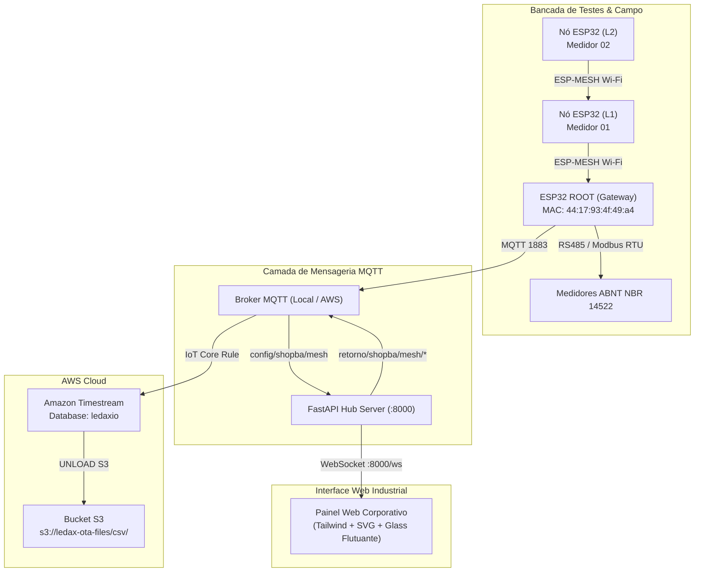

# ARQUITETURA.md - Documentação Permanente do Sistema

**Última Atualização**: 2026-11-13  
**Versão Atual**: `v2.7-pro`  
**Escopo**: Servidor de Telemetria, Orquestração ESP-MESH e Studio de Observabilidade Industrial da **Ledax Energy**.

---

## 1. Visão Geral da Arquitetura

O sistema é uma plataforma híbrida de observabilidade industrial e controle de bancada para medidores inteligentes de energia elétrica baseados no microcontrolador ESP32 com rede em malha (ESP-MESH) e comunicação em nuvem (AWS IoT Core & Amazon Timestream).

---

## 2. Subsistemas Principais

### 2.1 Backend FastAPI (`app.py`)
- **Servidor REST & WebSocket**: Porta padrão `8000`.
- **Roteador MQTT**: Subscreve tópicos de telemetria e retorno da malha (`retorno/shopba/mesh/#` e `dev/retorno/shopba/mesh/#`).
- **Amazon Timestream LiveAnalytics**:
  - Banco: `ledaxio` (Região `us-west-2`).
  - 7 Tabelas Mapeadas: `SHOPPBA-TESTE`, `test_connections`, `connections_mesh`, `connections`, `dev`, `refrix`, `water_gti`.
  - Exportador UNLOAD S3: Geração de SQL analítico e exportação direta sem compressão com delimitador `;` para Excel pt-BR.
- **Radar Sci-Fi & Observabilidade de Borda**:
  - Fasores polares de tensão e corrente com THD.
  - Sincronizador CSMA/CA heurístico para eliminação de colisões Wi-Fi na bancada.
  - Vigilante FreeRTOS de inversão de prioridade.
  - Vigilante Live Diff de Registradores Modbus (`40001` a `40012`).
  - Espectrograma RF de 14 canais 2.4GHz com recomendador dinâmico.

### 2.2 Frontend SPA (`static/index.html`)
- **Estética Corporativa Industrial**:
  - Superfícies principais sólidas em Slate escuro (`#0b0f19`, `#0f172a`, `#070b14`) com alto contraste para uso contínuo em turnos industriais.
  - **Vidro Fosco (*Glassmorphism*) Exclusivo nas Setinhas**: Menus flutuantes, seletores de funções, destinatários e caixas de diálogo modais utilizam desfoque cristalino com sombra suspensa.
- **Abas do Sistema**:
  1. `view-quick`: Ações rápidas de bancada em 1 clique.
  2. `view-builder`: Construtor de comandos MQTT (funções ABNT NBR 14522 e JSON).
  3. `view-devices`: Gestão de dispositivos, MACs, nomes e tipos.
  4. `view-tree`: Árvore topológica da malha ESP-MESH com zoom 4K/8K e conduítes de pacotes animados.
  5. `view-terminal`: Terminal serial e histórico de mensagens.
  6. `view-pubsub`: Publicador e assinante de tópicos MQTT em tempo real.
  7. `view-ota`: Gerenciador de atualizações de firmware Over-the-Air.
  8. `view-timestream`: Estúdio visual Amazon Timestream com 7 tabelas e UNLOAD S3.
  9. `view-scifi`: Radar de observabilidade avançada de rádio, térmica e fasores elétricos.
  10. `device-cockpit-drawer`: Gaveta Lateral Deslizante (Slide-over Drawer / Tela Cheia) do Cockpit 360° de Codax Específico:
      - **Endpoint Backend**: `GET /api/devices/{mac}/cockpit` (Telemetria, Topologia, Power Reasons, Timestream, Logs e OTA em < 20ms).
      - **Telemetria Completa**: Va, Vb, Vc, Ia, Ib, Ic, Potência Ativa (kW), Reativa (kvar), cos φ, Frequência, THD-V/I, Temperatura do silício (°C) e RSSI/RTT.
      - **Micro-Topologia de Malha**: Parente (Pai), Filhos conectados, Canal Wi-Fi e Mesh ID.
      - **AWS Timestream & Power Reasons**: Histórico de códigos de reset do ESP32 (`POWERON_RESET`, `SW_CPU_RESET`, `BROWNOUT_RESET`, `TG0WDT`) e tabela das últimas 20 leituras da placa.
      - **Terminal Filtrado**: Console ao vivo e envio de comandos estritamente para o MAC em foco.
      - **Central OTA**: Status de partição ativa (`ota_0`/`ota_1`) e disparo de firmware (.bin) para a placa selecionada.
      - **Menu Setinha MQTT (Glassmorphism)**: Dropdown em vidro fosco com comandos agrupados em `Query`, `Change` e `Settings`.

---

## 3. Invariantes de Dados
- **`devices.json`**: Cadastro persistido de dispositivos com chaves MAC limpas (12 caracteres hexadecimais em minúsculo, ex: `4417934f49a4`).
- **Formatação pt-BR**: Leituras de totalizadores elétricos utilizam vírgula como separador decimal (`1403,5`, `1538,5`...) e ponto como separador de milhar.
