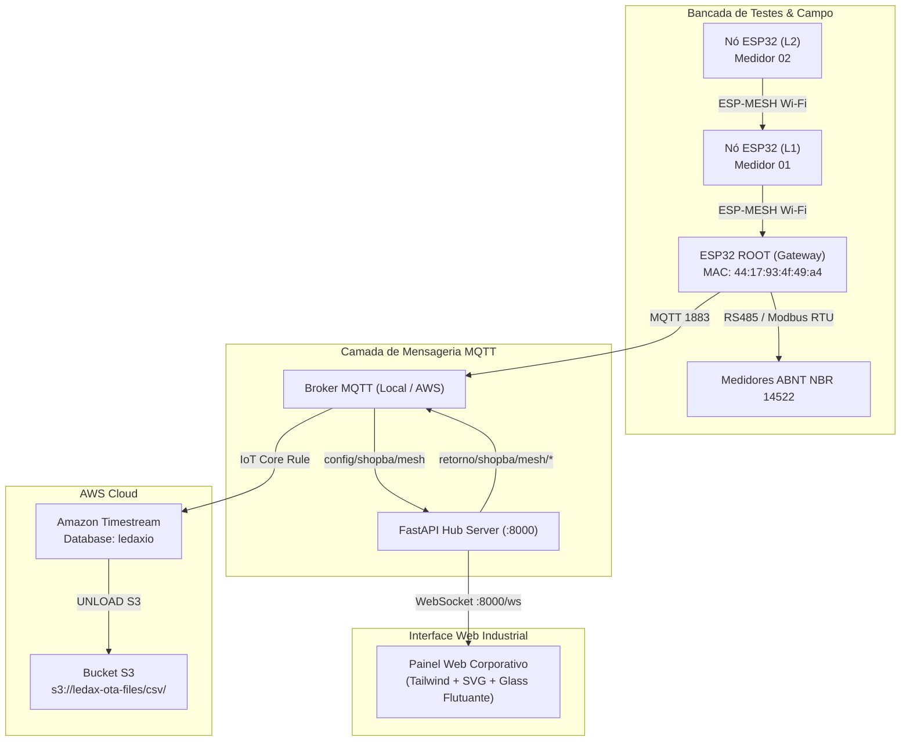

# ARQUITETURA.md - Documentação Permanente do Sistema

**Última Atualização**: 2026-11-14  
**Versão Atual**: `v2.8-pro`  
**Escopo**: Servidor de Telemetria, Orquestração ESP-MESH e Studio de Observabilidade Industrial da **Ledax Energy**.

---

## 1. Visão Geral da Arquitetura

O sistema é uma plataforma híbrida de observabilidade industrial e controle de bancada para medidores inteligentes de energia elétrica baseados no microcontrolador ESP32 com rede em malha (ESP-MESH) e comunicação em nuvem (AWS IoT Core & Amazon Timestream).

---

## 2. Subsistemas Principais

### 2.1 Backend FastAPI (`app.py`)
- **Servidor REST & WebSocket**: Porta padrão `8000`.
- **Roteador MQTT**: Subscreve tópicos de telemetria e retorno da malha (`retorno/shopba/mesh/#` e `dev/retorno/shopba/mesh/#`).
- **Amazon Timestream LiveAnalytics**:
  - Banco: `ledaxio` (Região `us-west-2`).
  - 7 Tabelas Mapeadas: `SHOPPBA-TESTE`, `test_connections`, `connections_mesh`, `connections`, `dev`, `refrix`, `water_gti`.
  - Exportador UNLOAD S3: Geração de SQL analítico e exportação direta sem compressão com delimitador `;` para Excel pt-BR.
- **Radar Sci-Fi & Observabilidade de Borda**:
  - Fasores polares de tensão e corrente com THD.
  - Sincronizador CSMA/CA heurístico para eliminação de colisões Wi-Fi na bancada.
  - Vigilante FreeRTOS de inversão de prioridade.
  - Vigilante Live Diff de Registradores Modbus (`40001` a `40012`).
  - Espectrograma RF de 14 canais 2.4GHz com recomendador dinâmico.
  - **Tomografia RF & Radar Wi-Fi CSI (Channel State Information)**:
    - Endpoints `/api/csi/status`, `/api/csi/{mac}`, `/api/csi/calibrate`, `/api/csi/burst`.
    - Algoritmo de entropia espectral e extração das 64 subportadoras OFDM para detecção de perturbação e movimento sem câmeras.
  - **Engine de Linha do Tempo Sci-Fi de Topologia**:
    - Endpoints `/api/scifi/metrics` e `/api/scifi/simulate-event`.
    - Registro cronológico de transições de camada (`L1 ROOT ⇄ L2/L3 NODE`), handovers e reconexões ESP-MESH.

### 2.2 Frontend SPA (`static/index.html`)
- **Estética Corporativa Industrial (Zero Glassmorphism)**:
  - Design estritamente Dark Carbon Industrial SCADA (`#070b14`, `#0b1120`, `#0f172a`) com bordas sólidas Slate (`#1e293b`, `#334155`), tipografia de alto contraste e zero desfoque (`backdrop-filter: none !important`).
  - **Tema SCADA Dark High-Contrast**: Modo alternativo de alto contraste para bancadas industriais (paleta âmbar fosforescente `#ffb000` e ciano laser `#00f0ff` sobre preto profundo `#06090e`, ativável no cabeçalho em 1 clique).
- **Abas do Sistema**:
  1. `view-quick`: Ações rápidas de bancada em 1 clique.
  2. `view-builder`: Construtor de comandos MQTT (funções ABNT NBR 14522 e JSON).
  3. `view-devices`: Gestão de dispositivos, MACs, nomes, tipos e **Exportador de Dossiê Técnico HTML Único** (relatório executivo offline para auditoria e impressão).
  4. `view-tree`: **Árvore Topológica ESP-MESH Panorâmica & Conduítes Laser Cyberpunk**:
      - **Linhas Animadas de Fluxo de Pacotes (Conduítes Laser Z-20)**: Renderização vetorial SVG de alta definição com duto escuro industrial (`#070b13`), trilho de fibra ótica (`#141c2c`), feixe laser contínuo em CSS GPU com cores por estado de sinal (Ciano &gt; -65dBm, Esmeralda, Âmbar) e partículas de fóton plasma viajantes via `animateMotion`.
      - **Docking Ports Industriais**: Sockets de ancoragem física iluminados nas bordas inferiores (saída pai) e superiores (entrada filho) de cada placa.
      - **Flashes de Tráfego de Dados em Tempo Real**: Conduítes disparam pulsos instantâneos de alta luminosidade (`.tree-conduit-data-burst`) sincronizados com mensagens MQTT via WebSocket.
      - **Inovações Vadims06/topolograph**:
        - **Inspeção de Caminho Mais Curto (Shortest Path)**: Ao focar em qualquer nó, traça e ilumina todo o trajeto desde o ROOT com laser azul-gelo de alto brilho (`#38bdf8`), destacando saltos e métricas de rota.
        - **Simulador de Falha de Enlace / Nó**: Botão em cada card para simular queda de nó, transformando o conduíte em feixe vermelho tracejado piscante de alerta (`#f43f5e`) e alertando sobre rotas isoladas.
      - **Métricas IoT edfungus/Crouton & Freeboard**: HUD superior com Vazão da Malha em tempo real (PPS), LQI Médio de Rádio (%), contagem de malhas ativas e enlaces.
      - **Visão Matriz de Adjacência N x N em 4K** (heatmap de enlaces RF) e **Histórico de Mudanças de Topologia em Linha do Tempo**.
  5. `view-terminal`: Terminal serial e histórico de mensagens.
  6. `view-pubsub`: Publicador e assinante de tópicos MQTT em tempo real.
  7. `view-ota`: Gerenciador de atualizações de firmware Over-the-Air.
  8. `view-timestream`: **Estúdio Visual Amazon Timestream & UNLOAD S3**:
      - 5 Sub-Abas operacionais: `Séries & Curvas Elétricas`, `Catálogo das 7 Tabelas`, `Construtor UNLOAD S3`, `Console SQL & Queries`, e `Qualidade de Energia (PQI)`.
      - Gráficos vetoriais de alta resolução: Tensões Trifásicas (Va, Vb, Vc) com faixas normativas ANEEL (201V a 231V), Corrente (A) & Demanda Ativa (kW), Totalizador pt-BR contínuo e RSSI MESH.
      - Seletor de janela temporal: 15m, 1h, 6h, 24h, 7d e histórico consolidado.
      - Biblioteca de 6 presets SQL industriais em 1 clique (Totalizador, VTCD, Demanda de Pico, Saltos de Camada, Auditoria de Resets e Gaps).
      - Painel de Indicadores de Qualidade de Energia (PRODIST Módulo 8 da ANEEL: Desbalanço trifásico, Frequência, Fator de Potência).
      - Exportador de dados para CSV pt-BR (delimitador `;`), JSON e comando analítico UNLOAD TO S3 sem compressão.
  9. `view-scifi`: Radar de observabilidade avançada, **Diagrama Sankey de Fluxo MQTT por Tópico** (com curvas de Bézier animadas e modos volume vs largura de banda), **Detector de Gaiola de Faraday & Desvanecimento por Multipath RF (&lambda;=12.5cm)** e fasores elétricos.
  10. `device-cockpit-drawer`: Gaveta Lateral Deslizante (Slide-over Drawer / Tela Cheia) do Cockpit 360° de Codax Específico:
      - **Endpoint Backend**: `GET /api/devices/{mac}/cockpit` (Telemetria, Topologia, Power Reasons, Timestream, Logs e OTA em < 20ms).
      - **Telemetria Completa**: Va, Vb, Vc, Ia, Ib, Ic, Potência Ativa (kW), Reativa (kvar), cos φ, Frequência, THD-V/I, Temperatura do silício (°C) e RSSI/RTT.
      - **Micro-Topologia de Malha**: Parente (Pai), Filhos conectados, Canal Wi-Fi e Mesh ID.
      - **AWS Timestream & Power Reasons**: Histórico de códigos de reset do ESP32 (`POWERON_RESET`, `SW_CPU_RESET`, `BROWNOUT_RESET`, `TG0WDT`) e tabela das últimas 20 leituras da placa.
      - **Terminal Filtrado**: Console ao vivo e envio de comandos estritamente para o MAC em foco.
      - **Central OTA**: Status de partição ativa (`ota_0`/`ota_1`) e disparo de firmware (.bin) para a placa selecionada.
      - **Gêmeo Digital Holográfico 3D (Sub-aba 6)**: Renderização Three.js/WebGL em tempo real da placa ESP32 com LEDs dinâmicos vinculados ao MQTT, mapa térmico da CPU, **mapeamento interativo dos 30 pinos físicos** com hover raycasting e níveis de tensão (HIGH/LOW/Touch/RS485), **cabo virtual e módulo ESP-Prog Plug & Play** sincronizado automaticamente com a porta USB/Serial e **conduíte laser de pacotes de dados RS485** com partículas fótons em tempo real.
      - **Radar Wi-Fi CSI & Tomografia RF (Sub-aba 7 & Modal)**: Sonar polar com varredura contínua de feixe, decaimento fosforescente, 64 subportadoras OFDM e detecção de movimento volumétrico.
      - **Menu Corporativo MQTT**: Dropdown em Solid Dark Carbon com comandos agrupados em `Query`, `Change` e `Settings`.
      - **Faixa Docked Inferior (Carrossel Horizontal de Codax)**: Barra fixa ancorada no rodapé da gaveta com carrossel deslizante suave dos outros Codax da bancada, anel luminoso no dispositivo ativo (`ATIVO`), métricas de RSSI, RTT e protocolo de medidor, permitindo alternância instantânea sem fechar o Cockpit.
  11. `view-serial`: **Monitor Serial USB (ESP-Prog & UART Direta)**:
      - Espelhamento em tempo real da saída serial física via Web Serial API nativa (`navigator.serial`) a 115.200 bps (ou 74.880 ROM / 921.600 bps).
      - Decodificação ANSI em tempo real de logs do ESP-IDF (`[I]` Verde, `[W]` Amarelo, `[E]` Vermelho, `[ROM]` Roxo).
      - Controles de Hardware DTR/RTS para reset remoto da placa (`EN`) e ativação do modo bootloader (`GPIO0`).
      - Detector automático de SoftAP (`CODAX_XXXXXX`) e IP local (`192.168.4.1`) na saída da UART.
  12. `view-webserver`: **Webserver Local do ESP32 & Portal de Comissionamento**:
      - Acesso embutido e externo ao portal de configuração HTTP do ESP32 (`http://192.168.4.1`), operando 100% offline mesmo com a AWS fora do ar.
      - Mecanismo de contingência para forçar o modo Webserver a qualquer momento (via comando serial de NVS ou MQTT `config_state`).
      - Painel de credenciais de fábrica (`user/user` e `dev/admin`) com atalhos de consulta e reset de senha.
      - **Modo Visão Dividida (Split Screen)**: Visualização simultânea 50%/50% do Monitor Serial e do Webserver para comissionamento assistido em bancada.
  13. **Módulos Globais de Bancada**:
      - **Caixa Preta de Telemetria com Replay Instantâneo (Time-Travel Debugger)**: Ring buffer circular em RAM com os últimos 10 minutos de telemetria da bancada e scrubbing temporal instantâneo.
      - **Inspetor Ciberpunk de Linha do Tempo de Topologia**: Modal interativo em tela cheia com régua cronológica de migrações de camada (`L1/L2/L3`), handovers e reconexões ESP-MESH.
      - **Cofre de Inovações Codax Hub**: Catálogo pesquisável com filtros por categoria, busca textual em tempo real e ficha técnica TRL-9 completa.

---

## 3. Invariantes de Dados
- **`devices.json`**: Cadastro persistido de dispositivos com chaves MAC limpas (12 caracteres hexadecimais em minúsculo, ex: `4417934f49a4`).
- **Formatação pt-BR**: Leituras de totalizadores elétricos utilizam vírgula como separador decimal (`1403,5`, `1538,5`...) e ponto como separador de milhar.

---

## 4. Modern Deep Dark Obsidian Design System (Inspirado em dark.design & Behance)
- **Zero Glassmorphism & Erradicação Total de Translucidez**: Regra universal estrita (`backdrop-filter: none !important;` e `-webkit-backdrop-filter: none !important;`). Nenhuma classe de opacidade fracionária do Tailwind (`bg-.../80`, `/70`, `/60`, etc.) gera canal alfa; todas são forçadas via seletores de atributo a 100% de opacidade sólida.
- **Hierarquia de Superfícies Ultra-Dark**:
  - **Fundo / Canvas Geral**: `#030508` com gradiente radial sutil de ancoragem (`radial-gradient(ellipse 90% 55% at 50% -15%, rgba(15, 23, 42, 0.45), transparent 70%)`).
  - **Painéis Principais & Cards**: `#080c14` (Matte Carbon Sólido) com micro-borda cirúrgica `#131b28` e hairline superior zenital (`inset 0 1px 0 rgba(255, 255, 255, 0.05)`).
  - **Sub-containers & Headers**: `#0d121e` sólido com borda `#172235`.
  - **Poços Rebaixados & Terminais CRT**: `#020306` (Preto Jet Absoluto) com rebaixo debossed profundo (`inset 0 2px 6px rgba(0, 0, 0, 0.95)`).
  - **Badges de Status Sólidos**: Tons ricos escuros (`#021a12`, `#031a24`, `#0a0e29`, `#150826`, `#1c1003`, `#22050c`) com texto neon fosforescente de alto contraste.
- **Botões Táteis Modernos (Tactile Micro-Press)**:
  - `.btn-card` e controles da barra superior com gradiente linear metálico escuro (`#0e1422` a `#070a13`), borda superior iluminada (`#263652`) e resposta física tátil de clique (`:active { transform: translateY(1px); }`).
- **Modais & Overlays de Foco**:
  - Caixas flutuantes em `#070b13` com oclusão profunda (`0 28px 60px -10px rgba(0, 0, 0, 0.99)`).
  - Backdrops de modal escurecidos uniformemente (`rgba(1, 2, 4, 0.93)`), eliminando o aspecto de vidro translúcido.
